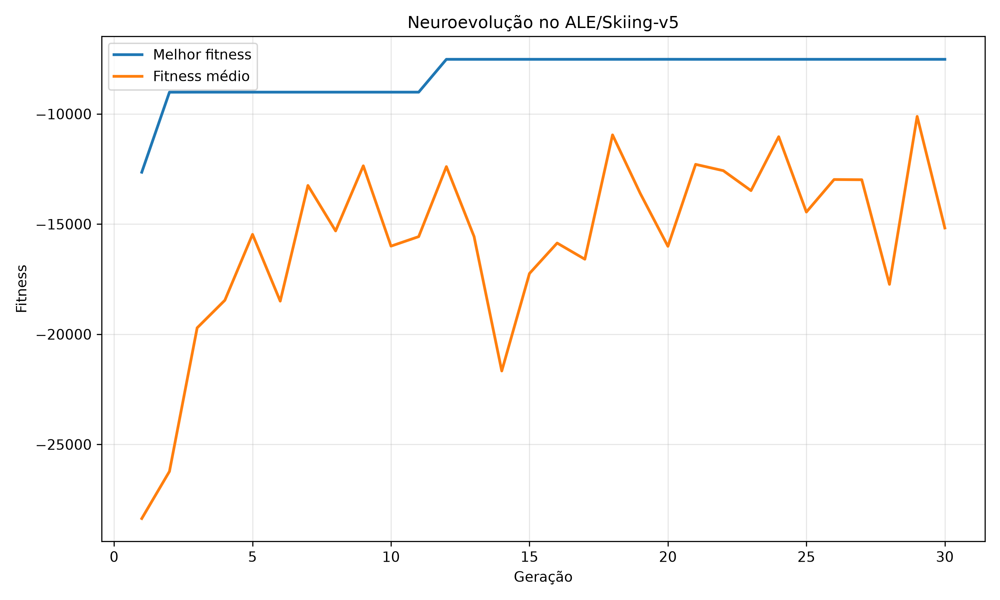

# Neuroevolução no Atari Skiing

Projeto desenvolvido na disciplina de Fundamentos de Inteligência Artificial. A proposta foi utilizar um algoritmo evolutivo para ajustar os pesos de uma rede neural responsável por controlar um agente no jogo Atari Skiing.

## Ambiente e implementação

Foi utilizado o ambiente `ALE/Skiing-v5`, com observação pela memória RAM do Atari (`obs_type="ram"`).

Cada agente possui uma rede neural com 128 entradas, 16 neurônios na camada oculta e 3 saídas, correspondentes às ações NOOP, RIGHT e LEFT. Os valores da RAM são normalizados, e a rede utiliza a função `tanh` na camada oculta.

O fitness é calculado pela soma das recompensas recebidas durante uma partida. Como as pontuações são negativas, quanto mais próximo de zero, melhor o resultado.

## Configuração do algoritmo

| Parâmetro | Valor |
|---|---|
| População | 20 agentes |
| Gerações | 30 |
| Seleção | Torneio com 3 agentes |
| Elitismo | 2 melhores agentes |
| Taxa de mutação padrão | 10% |
| Intensidade padrão | 0,20 |
| Reprodução | Cópia dos pesos, sem crossover |

A seleção é feita por torneio: três agentes são escolhidos aleatoriamente, e o de maior fitness é selecionado como pai. Esse método favorece os melhores indivíduos sem limitar a seleção apenas a eles.

Os dois melhores agentes são preservados a cada geração. Os demais são criados por cópia e mutação dos pesos dos pais selecionados.

A mutação adiciona ruído gaussiano aos parâmetros da rede neural.

## Experimentos

Foram testadas três configurações de mutação, mantendo 20 agentes e 30 gerações em cada execução.

| Experimento | Taxa | Intensidade | Melhor fitness |
|---|---:|---:|---:|
| A | 1% | 0,05 | -7902 |
| B | 10% | 0,20 | -6528 |
| C | 40% | 0,50 | -6528 |

Os experimentos B e C tiveram os melhores resultados, ambos com fitness de -6528. O experimento A ficou em -7902.

O gráfico comparativo está em `resultados/experimentos/comparacao.png`.

## Evolução do fitness

O gráfico abaixo mostra o melhor fitness e a média da população ao longo das 30 gerações do treinamento principal.



No treinamento principal, o melhor fitness encontrado foi -7520. A média da população apresentou oscilações ao longo das gerações, mesmo após a identificação de agentes com pontuações melhores.

## Exploração e convergência

A exploração acontece principalmente na mutação, quando os pesos e vieses dos descendentes são alterados aleatoriamente. Mutações menores produzem alterações mais discretas, enquanto mutações maiores permitem explorar soluções mais diferentes das anteriores.

Nos nossos experimentos, as configurações B e C encontraram resultados superiores à configuração A. Isso indica que, nessas execuções, uma mutação mais intensa favoreceu a descoberta de agentes com recompensas melhores.

Por outro lado, os melhores valores de fitness ficaram estabilizados durante várias gerações, enquanto a média continuou oscilando. Isso indica uma estabilização dos melhores resultados, mas não uma convergência completa da população.

Na visualização de um agente treinado, percebemos que ele utilizava quase sempre a ação NOOP: foram 527 ações NOOP, 3 LEFT e nenhuma RIGHT. Portanto, apesar da melhora no fitness, o agente ainda não desenvolveu uma estratégia consistente de movimentação pelas bandeiras.

## Comparação com agente aleatório

Também testamos um agente que escolhe suas ações aleatoriamente, em cinco partidas.

| Execução | Fitness |
|---|---:|
| 1 | -14364 |
| 2 | -15681 |
| 3 | -16480 |
| 4 | -16166 |
| 5 | -16817 |
| **Média** | **-15901,60** |

O melhor fitness encontrado pela neuroevolução (-6528) foi superior ao melhor resultado do agente aleatório (-14364).

Essa comparação considera os resultados observados, sem uma avaliação estatística mais ampla ou testes repetidos dos agentes evoluídos nas mesmas condições.

## Organização do código

| Arquivo | Responsabilidade |
|---|---|
| `agente.py` | Rede neural e escolha das ações |
| `ambiente.py` | Avaliação e cálculo do fitness |
| `populacao.py` | Criação dos agentes |
| `evolucao.py` | Seleção, mutação e elitismo |
| `main.py` | Execução das 30 gerações |
| `experimentos.py` | Experimentos A, B e C |
| `resultados.py` | Salvamento dos gráficos, CSVs e pesos |
| `teste_aleatorio.py` | Comparação com agente aleatório |
| `visualizar_agente.py` | Visualização do agente treinado |
| `config.py` | Parâmetros do treinamento |

## Como executar

Instale as dependências:

```bash
pip install -r requirements.txt
```

Treinamento principal:

```bash
python main.py
```

Experimentos de mutação:

```bash
python experimentos.py
```

Teste com agente aleatório:

```bash
python teste_aleatorio.py
```

Visualização do agente salvo:

```bash
python visualizar_agente.py
```

As configurações já estão definidas no código, sem necessidade de alterações manuais para executar os experimentos.

Os históricos, gráficos e pesos das redes treinadas estão na pasta `resultados/`.

## Considerações finais

O algoritmo conseguiu melhorar o fitness ao longo das gerações, e os experimentos mostraram diferenças entre as configurações de mutação.

A principal limitação foi o comportamento dos agentes, que ainda apresentaram pouca movimentação durante o jogo. Para melhorar isso, poderíamos testar uma função de fitness que valorizasse diretamente a passagem pelas bandeiras, além de avaliar cada agente em mais de uma partida para reduzir a influência da aleatoriedade.